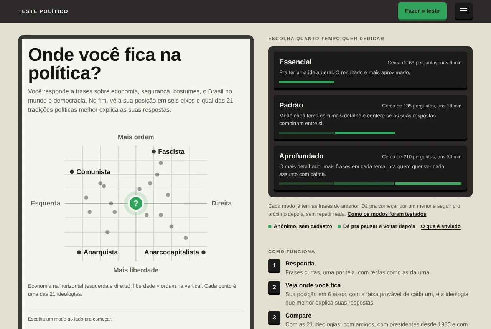
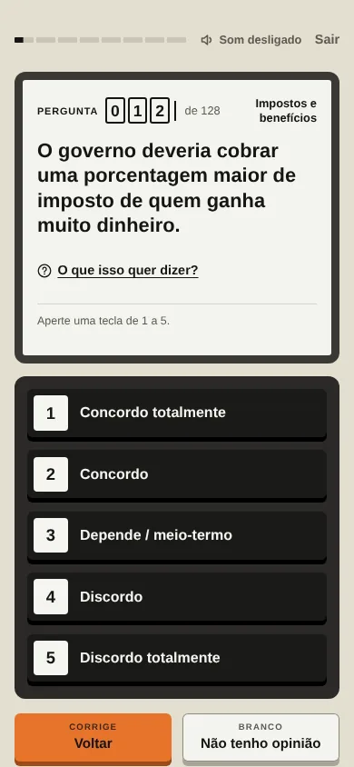
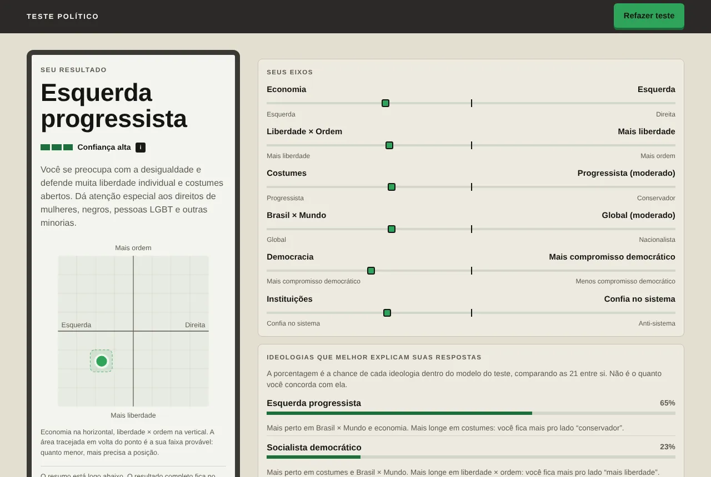

<div align="center">


# Teste Político

**Descubra onde você fica na política brasileira: seis eixos, 21 tradições políticas e o grau de confiança do resultado.**

[](https://testepolitico.vercel.app)
[](https://github.com/andrxzinho/teste-politico/actions/workflows/testes.yml)
[](LICENSE)

### [Fazer o teste →](https://testepolitico.vercel.app)

[Metodologia](https://testepolitico.vercel.app/metodologia.html) ·
[Ideologias](https://testepolitico.vercel.app/ideologias/) ·
[Perguntas frequentes](https://testepolitico.vercel.app/perguntas-frequentes/) ·
[Privacidade](https://testepolitico.vercel.app/termos.html)

<picture>
  <source media="(prefers-color-scheme: dark)" srcset="docs/img/inicio-escuro.webp">
  
</picture>

</div>

> [!NOTE]
> Projeto independente e sem fins lucrativos, sem ligação com partidos, candidatos, governos ou a Justiça Eleitoral.
> O visual se inspira na urna eletrônica, sem usar símbolos oficiais. O resultado é uma aproximação feita por um modelo
> estatístico, não um diagnóstico, e a compatibilidade com candidatos não é recomendação de voto.

## Sumário

- [O que é](#o-que-é)
- [Destaques](#destaques)
- [Como funciona](#como-funciona)
- [Privacidade](#privacidade)
- [Tecnologias](#tecnologias)
- [Rodar no computador](#rodar-no-computador)
- [Testes](#testes)
- [Estrutura do projeto](#estrutura-do-projeto)
- [Documentação](#documentação)
- [Contribuir](#contribuir)
- [Licença](#licença)

## O que é

Um teste de orientação política feito para o contexto brasileiro. Você responde a frases concretas sobre economia,
segurança, costumes, o Brasil no mundo, democracia e instituições, e recebe:

- a sua posição em **seis eixos**, cada um com a faixa provável (a margem de erro da posição);
- as **ideologias que melhor explicam as suas respostas**, entre 21 tradições políticas, com a probabilidade relativa
  de cada uma dentro do modelo e um indicador de confiança (alta, média ou baixa);
- as tensões e possíveis contradições nas suas respostas;
- a compatibilidade estimada com candidatos de 2026, pensadores e figuras históricas;
- leituras recomendadas a favor e contra a tradição mais próxima;
- uma imagem e um link para comparar o resultado com amigos.

<table>
<tr>
<td width="32%"></td>
<td></td>
</tr>
</table>

## Destaques

| | |
|---|---|
| 🧭 **Contexto brasileiro** | Frases sobre temas do país, cada uma com explicação, exemplo prático e o melhor argumento de cada lado. |
| ⏱️ **Três modos** | Essencial, Padrão e Aprofundado. Dá pra continuar no modo seguinte sem repetir nenhuma frase. |
| 📊 **Resultado honesto** | Mostra a margem de erro, a confiança e as contradições, e diferencia probabilidade de semelhança. |
| 🔒 **Privado por padrão** | Todo o cálculo acontece no seu aparelho. Suas respostas só saem dele se você aceitar participar do estudo. |
| ♿ **Acessível** | Testado com axe-core (WCAG 2.1 A e AA), teclado, temas claro e escuro, do celular ao computador. |

## Como funciona

| | |
|---|---|
| **Modos** | Essencial, Padrão e Aprofundado: cerca de 65, 135 e 210 frases (exatamente 62–70, 128–139 e 205–216, conforme as respostas, mais até 6 de desempate). Cada modo inclui as frases do anterior. |
| **Eixos** | Economia, Liberdade × Ordem, Costumes, Brasil × Mundo, Democracia e Instituições. |
| **Classificação** | Para cada ideologia, o modelo compara a sua posição em cada subtema com a posição típica daquela tradição, levando em conta a margem de erro. A porcentagem é a **probabilidade relativa dentro do modelo**, não uma medida de quanto você "é" daquela ideologia. |
| **Extremos** | Comunismo, anarquismo, fascismo e anarcocapitalismo só aparecem quando você concorda com as frases que definem cada um. |
| **Consistência** | Pares de frases opostas, simetria partidária (a mesma situação com o lado trocado), tendência a concordar com tudo e respostas no automático reduzem a confiança. |
| **Confiança** | Junta a probabilidade da primeira ideologia, a precisão dos eixos e a consistência. Diz quão claro o resultado ficou dentro do modelo, não se o teste acertou. |

A [metodologia](https://testepolitico.vercel.app/metodologia.html) explica o cálculo e os limites. As simulações usadas
para calibrar os modos usam respondentes artificiais e **não equivalem a uma validação com pessoas reais**. Os
problemas conhecidos e as propostas de melhoria estão em [docs/AUDITORIA-METODOLOGIA.md](docs/AUDITORIA-METODOLOGIA.md).

## Privacidade

- O teste funciona inteiro **sem enviar as suas respostas**: elas e o resultado ficam no seu navegador.
- Participar do estudo é opcional e exige consentimento. Quem participa envia o resultado sem nome, e-mail ou qualquer
  outro dado de identificação.
- O site não usa cookies nem rastreadores. O banco de dados só é acessível pelo servidor.

Detalhes na [política de privacidade](https://testepolitico.vercel.app/termos.html) e em
[docs/DADOS-E-PRIVACIDADE.md](docs/DADOS-E-PRIVACIDADE.md).

## Tecnologias

| Parte | Tecnologia |
|---|---|
| Site | HTML, CSS e JavaScript puro, sem framework e sem etapa de build (`public/`) |
| Servidor | Quatro funções no [Vercel](https://vercel.com), região São Paulo (`api/` → `servidor/rotas/`) |
| Banco | Postgres no [Supabase](https://supabase.com), em São Paulo, acessado só pelo servidor (`supabase/esquema.sql`) |
| Testes | Node.js, [Playwright](https://playwright.dev) e [axe-core](https://github.com/dequelabs/axe-core) |
| Outros | [qrcode-generator](https://github.com/kazuhikoarase/qrcode-generator) (MIT) e a fonte [Arimo](https://fonts.google.com/specimen/Arimo) (Apache 2.0) |

## Rodar no computador

Requisitos: [Node.js](https://nodejs.org) 20 ou mais recente e Git.

```bash
git clone https://github.com/andrxzinho/teste-politico.git
cd teste-politico
npm ci
npm run local             # abre o site em http://127.0.0.1:8080 (PORTA=3000 npm run local pra trocar a porta)
```

`npm run local` serve só a pasta `public/`, sem as funções do servidor. O teste funciona inteiro, porque o cálculo roda
no navegador. Fora do endereço oficial, o site mostra o selo "Modo teste" e nada é enviado ao estudo.

Para rodar também as funções do servidor, use a [CLI do Vercel](https://vercel.com/docs/cli) com o banco em memória,
sem precisar de Supabase:

```bash
cp .env.example .env      # e descomente BANCO=memoria
npx vercel dev
```

As variáveis de ambiente estão listadas, sem valores, em [`.env.example`](.env.example).

## Testes

```bash
npx playwright install chromium   # uma vez; ou aponte CHROMIUM_PATH para um Chromium já instalado
BANCO=memoria npm test            # todos os testes
```

| Comando | O que verifica |
|---|---|
| `npm run test:logica` | Simulação fixa das 21 ideologias nos três modos, comparada com a referência em `testes/referencia/` |
| `npm run test:perfis` | Perfis sintéticos (moderado, extremo, misto, contraditório, uniforme, incompleto): propriedades do cálculo, determinismo e simetria |
| `npm run test:numeros` | Os números publicados (perguntas por modo, ideologias, acerto das simulações) batem com o código |
| `npm run test:interface` | Os três modos no navegador, do início ao resultado, compartilhar e comparar, no celular e no computador |
| `npm run test:servidor` | Envios, dados inválidos ou adulterados, desafio anti-robô, limite de pedidos, painel e backup |
| `npm run test:paginas` | Páginas geradas, links internos, menu, tema e nada rolando para os lados |
| `npm run test:acessibilidade` | axe-core (WCAG 2.1 A e AA) nas telas e páginas principais, nos dois temas |
| `npm run test:cliques` | Todos os botões e links de cada tela, no celular e no computador |

A cada envio na `main` e em cada pull request, o GitHub Actions roda todos os testes, o `npm audit` e a conferência de
que as páginas geradas (`npm run paginas`) e as listas do servidor (`npm run listas`) estão em dia com os dados.

Os testes conferem se o código faz o que promete. Eles **não** mostram que o teste acerta a ideologia de pessoas reais.

## Estrutura do projeto

```
public/                 site estático, publicado como está
  index.html            telas do teste e do resultado
  js/nucleo/            motor de cálculo, classificação e estado
  js/dados/             frases, ideologias, candidatos, pensadores, leituras e glossário
  js/telas/             perguntas, resultado, candidatos, comparar, compartilhar...
  js/servicos/          envio ao estudo, imagem de compartilhar, fotos e capas
  ideologias/ ...       páginas geradas (npm run paginas)
  img/p, img/l          fotos de pessoas e capas de livros (créditos em /creditos/)
api/                    funções do Vercel (porta de entrada)
servidor/               rotas, acesso ao banco e listas compartilhadas
supabase/esquema.sql    tabelas, permissões e funções do banco
testes/                 testes automáticos
ferramentas/            geração de páginas, listas e imagens, servidor local e redirecionamento do endereço antigo
docs/                   metodologia, arquitetura, privacidade, desenvolvimento e auditorias
```

Cada envio na `main` publica o site automaticamente no Vercel, e cada pull request ganha uma prévia com endereço
próprio. O endereço antigo, `testepolitico.netlify.app`, só redireciona para o atual.

## Documentação

| Documento | Conteúdo |
|---|---|
| [Metodologia](docs/METODOLOGIA.md) | Eixos, frases, modos, cálculo, classificação, confiança, simulações e limites |
| [Auditoria da metodologia](docs/AUDITORIA-METODOLOGIA.md) | Revisão crítica das frases, eixos, ideologias e do cálculo, com propostas |
| [Auditoria das leituras](docs/AUDITORIA-LIVROS.md) | Revisão bibliográfica das recomendações de livros |
| [Arquitetura](docs/ARQUITETURA.md) | Arquivos, formato dos dados, servidor, banco, painel e segurança |
| [Dados e privacidade](docs/DADOS-E-PRIVACIDADE.md) | O que é coletado, o que nunca é, consentimento e proteções |
| [Desenvolvimento](docs/DESENVOLVIMENTO.md) | Como mudar frases e dados, testar e publicar |
| [Pendências](docs/PENDENCIAS.md) | O que já foi identificado e ainda não foi feito |
| [Histórico de versões](CHANGELOG.md) | O que mudou em cada versão |

## Contribuir

Achou uma frase enviesada, um dado errado ou um problema no site?
[Abra um aviso](https://github.com/andrxzinho/teste-politico/issues/new/choose): há modelos para problemas no site e
para frases ou dados. Para propor uma mudança no código, leia o [CONTRIBUTING.md](CONTRIBUTING.md) (regras de
neutralidade e o que não pode mudar sem proposta prévia) e rode os testes antes de abrir o pull request.

Falhas de segurança ou privacidade **não** devem ir para um aviso público: veja o [SECURITY.md](SECURITY.md).

## Licença

[PolyForm Strict 1.0.0](LICENSE). Você pode ler, baixar e rodar o código para fins não comerciais (estudo, pesquisa,
ensino, uso pessoal, organizações sem fins lucrativos e órgãos públicos). Não é permitido uso comercial, distribuir
cópias nem publicar versões modificadas. Por isso este é um projeto de **código-fonte público**, e não de "código
aberto" no sentido da [Open Source Initiative](https://opensource.org/osd).

Fotos e capas de livros pertencem aos seus autores e editoras. As licenças estão na
[página de créditos](https://testepolitico.vercel.app/creditos/).
